<div align="center">

# 🌿 The Ghost Jungle
### An Interactive Living Ecosystem for GitHub Profile READMEs

[](https://github.com/topics/github-readme)

<br/>

[](LICENSE)
[](#)
[](#)
[](#)

<p align="center">
  <b>Turn your GitHub profile into a mystical midnight canopy.</b><br/>
  Repositories awaken as floating spectral ghosts that organically evolve based on commit count, language, and stars.
</p>

[Summon Your Jungle](#-quick-start) • [Ghost Evolution Codex](#-ghost-evolution-codex) • [Themes](#-enchanted-themes) • [GitHub Action (Serverless)](#-zero-server-mode-github-actions) • [API Parameters](#-customization-parameters)

</div>

---

## ✨ Features

- 👻 **Living Repository Spirits**: Every public repository materializes as a floating supernatural ghost in the jungle canopy.
- ⚡ **Commit Evolution Engine**: Spirits evolve through 5 distinct supernatural tiers as commits increase—from timid round wisps to towering celestial titans.
- 🎨 **Language Soul Cores**: The inner core flame of each spirit glows in the GitHub language color (Python blue, Rust ember, TypeScript azure, JavaScript gold).
- 🌌 **Atmospheric Animated Canopy**: Swaying hanging banyan vines, drifting mist layers, bioluminescent mushrooms, blinking hollow eyes, and twinkling fireflies.
- 🛡️ **100% GitHub Camo Safe**: Built using native CSS keyframe animations inside pure vector SVG. No external JavaScript needed to render inside GitHub's strict image proxy.
- 🎵 **Interactive Companion Playground**: Includes an interactive web app with procedural Web Audio sound effects, live ghost inspection, and instant markdown embed generator.
- 🚀 **Two Ways to Run**:
  1. **Dynamic URL**: Add a single markdown line to your profile README.
  2. **Zero-Server GitHub Action**: Daily scheduled workflow that generates and commits the SVG directly to your repo.

---

## ⚡ Quick Start

Paste this into your profile `README.md` (replace `YOUR_USERNAME` with your GitHub username):

### Markdown
```markdown
[](https://your-domain.com/?username=YOUR_USERNAME)
```

### HTML
```html
<a href="https://your-domain.com/?username=YOUR_USERNAME">
  
</a>
```

> [!TIP]
> Replace `your-domain.com` with your deployed URL (e.g. on Vercel) or run locally using `npm start`.

---

## 🔮 Ghost Evolution Codex

Commits channel spiritual energy into your repositories, allowing them to break through evolution barriers:

| Tier | Name | Commit Threshold | Visual Attributes |
| :---: | :--- | :---: | :--- |
| **1** | **Lesser Wisp** | `1 - 9` commits | Cute round spirit orb, shy eyes, blushing cheeks, gentle float, single tail trail |
| **2** | **Forest Specter** | `10 - 49` commits | Wavy flowing ectoplasm skirt, almond eyes, spirit hand tendrils, inner flame core |
| **3** | **Phantom Stalker** | `50 - 199` commits | Spectral horns/ears, forehead rune, dual hovering shoulder wisps, dual undulating tails |
| **4** | **Wraith Archon** | `200 - 499` commits | Floating ethereal flame crown, multi-branching wing mantles, orbiting celestial fire motes |
| **5** | **Ancient Titan** | `500+` commits | Runic cosmic halo ring, imperial golden crown, 3 orbiting wisp familiars, colossal astral robe |

---

## 🎨 Enchanted Themes

Choose an environmental atmosphere that matches your profile aesthetic:

| Theme Name | Parameter | Atmosphere Preview |
| :--- | :--- | :--- |
| **Midnight Bayou** | `theme=midnight` | *(Default)* Deep obsidian night, cyan moonlight, bioluminescent cyan/blue flora |
| **Toxic Mangrove** | `theme=emerald` | Deep emerald marshland, toxic jade fog, glowing lime mushrooms |
| **Crimson Eclipse** | `theme=bloodmoon` | Blood moon sky, crimson eclipse aura, fiery ruby spirit flames |
| **Neon Undergrowth** | `theme=cyberpunk` | Synthwave purple canopy, hot pink eclipse, cyan/magenta electric fog |
| **Sunken Leviathan** | `theme=abyss` | Deep ocean trench, teal glowing tendrils, phosphorescent marine mist |

### Theme Preview: Neon Undergrowth (`cyberpunk`)
<div align="center">
  
</div>

---

## ⚙️ Customization Parameters

Customize the dynamic SVG endpoint with URL query parameters:

```
GET /api/ghost-jungle?username=:username&theme=:theme&limit=:limit&sort=:sort
```

| Parameter | Type | Default | Description |
| :--- | :---: | :---: | :--- |
| `username` | `string` | `octocat` | GitHub username whose repositories are summoned |
| `theme` | `string` | `midnight` | Color palette (`midnight`, `emerald`, `bloodmoon`, `cyberpunk`, `abyss`) |
| `limit` | `number` | `8` | Number of ghost repositories summoned (`1` to `10`) |
| `sort` | `string` | `commits` | Sort criteria: `commits` (highest tier first), `stars`, or `updated` |
| `width` | `number` | `880` | SVG viewport width |
| `height` | `number` | `500` | SVG viewport height |

---

## 🤖 Zero-Server Mode (GitHub Actions)

If you prefer **not** to host an API server, you can generate your jungle statically inside your GitHub Profile repository (`username/username`) using GitHub Actions!

1. Create a file at `.github/workflows/ghost-jungle.yml` in your profile repository:

```yaml
name: Update Ghost Jungle

on:
  schedule:
    - cron: '0 0 * * *' # Every midnight
  workflow_dispatch:

permissions:
  contents: write

jobs:
  generate:
    runs-on: ubuntu-latest
    steps:
      - name: Checkout Repository
        uses: actions/checkout@v4

      - name: Generate Jungle SVG
        run: |
          npx --yes github-ghost-jungle --username ${{ github.repository_owner }} --output ghost-jungle.svg

      - name: Commit & Push
        run: |
          git config --local user.email "action@github.com"
          git config --local user.name "Ghost Jungle Bot"
          git add ghost-jungle.svg
          git diff-index --quiet HEAD || git commit -m "🌿 Update Ghost Jungle [skip ci]"
          git push
```

2. Reference your local SVG in your profile `README.md`:
```markdown

```

---

## 💻 Local Development & Self-Hosting

### Prerequisites
- Node.js 18+ (tested on Node 20 & 24)
- npm

### Installation
```bash
# Clone the repository
git clone https://github.com/your-username/github-ghost-jungle.git
cd github-ghost-jungle

# Install dependencies
npm install

# (Optional) Set your GitHub Personal Access Token for higher rate limits
export GITHUB_TOKEN="ghp_your_token_here"

# Start the interactive server
npm start
```

Visit `http://localhost:3000` in your browser to explore the interactive playground with procedural sound and live preview.

### Testing SVG Generation
```bash
# Test all themes and tiers
npm test

# Generate a standalone SVG via CLI
node src/cli.js --username octocat --theme cyberpunk --output my-jungle.svg
```

---

## ☁️ 1-Click Vercel Deployment

This project includes `vercel.json` and `api/ghost-jungle.js` serverless handlers:

1. Fork or push this repository to GitHub.
2. Import the repository into [Vercel](https://vercel.com).
3. (Optional) Add `GITHUB_TOKEN` to Environment Variables in Vercel settings.
4. Deploy! Your API is instantly live at `https://your-project.vercel.app/api/ghost-jungle?username=...`.

---

## 📜 License

Distributed under the **MIT License**. Created with 🖤 for the GitHub community.
