<div align="center">

<a href="https://ghost-jungle.vercel.app">
  
</a>

# 👻 Ghost Jungle

**Your repositories, awakened.**

An animated GitHub profile README where every repository becomes a living ghost<br/>
that evolves with its commits and wanders a cinematic moonlit jungle.

[](https://ghost-jungle.vercel.app)
[](https://ghost-jungle.vercel.app/wiki.html)

[](LICENSE)
[](#-how-it-works)
[](#-how-it-works)
[](https://github.com/AtlasRoX)

[Quick start](#-quick-start) · [Parameters](#%EF%B8%8F-parameters) · [Spirits](#-the-five-spirits) · [Ranks](#-canopy-ranks) · [Themes](#-themes) · [GitHub Action](#-zero-server-github-action) · [Self-hosting](#%EF%B8%8F-self-hosting)

</div>

---

## ✨ Features

- 👻 **A spirit for every repository.** Each public, non-fork repo becomes a ghost. Commits make it evolve through five stages, from a shy wisp to an antlered forest titan.
- 🎬 **Cinematic scene.** Volumetric moonlight, clouds crossing the moon, layered parallax jungle, drifting mist, fireflies, falling leaves, shooting stars, vignette and film grain.
- 🌫️ **Natural motion.** Every spirit wanders its own random route, lingers, drifts beyond the frame and returns, and grows as it comes toward you. Cloth ripples, eyes blink and glance, lanterns swing.
- 🎨 **Language soul light.** Each spirit glows in its repository's official GitHub language color.
- 📊 **Exact numbers.** Real default-branch commit counts, stars, forks and followers from the GitHub API. No estimates when a token is set.
- 🏆 **Canopy rank.** A percentile rank from `C` to `SS` with a dial in the scene and a full breakdown on the site.
- 🕹️ **Interactive playground.** Drag and throw spirits, double-click to startle them, watch small ones flee your cursor while titans come closer. Live inspector, rank card and embed builder.
- 📚 **Wiki.** Every tier, every rank, the exact formula, a rank calculator and how each number is counted.
- 🛡️ **Safe anywhere.** Pure SVG with CSS and SMIL animation, no scripts, embedded font. Works inside GitHub's image proxy and respects `prefers-reduced-motion`.

---

## ⚡ Quick start

1. Open **[ghost-jungle.vercel.app](https://ghost-jungle.vercel.app)**, type your username, pick a theme and how many spirits to show.
2. Copy the embed and paste it into your profile `README.md` (the repository named `username/username`).

Or paste this directly, replacing `YOUR_USERNAME`:

```markdown
[](https://ghost-jungle.vercel.app/?username=YOUR_USERNAME)
```

HTML version, if you want it to fill the column:

```html
<a href="https://ghost-jungle.vercel.app/?username=YOUR_USERNAME">
  
</a>
```

> [!TIP]
> GitHub caches README images for about an hour, so new commits show up within roughly an hour.

---

## ⚙️ Parameters

```
GET https://ghost-jungle.vercel.app/api/ghost-jungle?username=…&theme=…&limit=…&sort=…
```

| Parameter | Values | Default | Description |
| :--- | :--- | :---: | :--- |
| `username` | GitHub username | `octocat` | Whose repositories are summoned |
| `theme` | `midnight` · `emerald` · `bloodmoon` · `cyberpunk` · `abyss` | `midnight` | Atmosphere and color palette |
| `limit` | any number, or `all` | `10` | How many spirits: top 10 by default, `limit=20` for 20, `limit=all` for every repository (up to 36 in the image) |
| `sort` | `commits` · `stars` · `updated` | `commits` | Which repositories count as the top ones |
| `width` | number | `880` | Output width. The 880×400 (2.2:1) scene scales without reflowing |
| `height` | number | width ÷ 2.2 | Output height |

Examples:

```markdown
<!-- top 20 by stars, crimson theme -->


<!-- every repository -->

```

---

## 👻 The five spirits

A spirit's stage comes from the commit count on its repository's default branch.

| Tier | Spirit | Commits | Form and motion |
| :---: | :--- | :---: | :--- |
| **I** | **Lesser Wisp** | 1 – 9 | Round newborn light, big curious eyes, blushing cheeks. Fast, darting, shy |
| **II** | **Forest Specter** | 10 – 49 | Grows sleeves of mist that wave as it drifts |
| **III** | **Phantom Stalker** | 50 – 199 | A shadow hood; only its language-lit eyes glow inside |
| **IV** | **Wraith Archon** | 200 – 499 | Tattered cloak strands and a swinging lantern holding its soul flame |
| **V** | **Ancient Titan** | 500+ | Living glowing antlers, a gem sigil and a court of orbiting wisps |

Every spirit breathes with squash and stretch, blinks, glances around and sheds ectoplasm. In the playground, wisps, specters and phantoms flee your cursor; wraiths and titans are curious and come closer.

---

## 🏆 Canopy ranks

Your rank estimates where your profile sits among GitHub users. It blends four signals from your public, non-fork repositories.

| Rank | Title | Range |
| :---: | :--- | :--- |
| **SS** | Mythic Sovereign | top 1% |
| **S** | Ancient Elder | top 5% |
| **A+** | Wraith Lord | top 12.5% |
| **A** | Haunted Keeper | top 25% |
| **B+** | Awakened Seer | top 37.5% |
| **B** | Wandering Soul | top 50% |
| **C** | Whispering Sprout | everyone else |

| Signal | Median | Weight | Curve |
| :--- | :---: | :---: | :--- |
| Commits | 250 | 2 | exponential `1 − 2^(−x)` |
| Stars | 50 | 4 | log-normal `x / (1 + x)` |
| Followers | 10 | 1 | log-normal `x / (1 + x)` |
| Repositories | 12 | 1 | exponential `1 − 2^(−x)` |

`x = value ÷ median`, `score = Σ(weight × curve) ÷ Σ weight`, `top % = (1 − score) × 100`.
Try your own numbers in the [Wiki calculator](https://ghost-jungle.vercel.app/wiki.html#ranks). This is an estimate from public data, not an official GitHub statistic.

---

## 🎨 Themes

| Theme | `theme=` | Atmosphere |
| :--- | :--- | :--- |
| **Midnight Bayou** | `midnight` | Deep blue night, cyan moonlight *(default)* |
| **Toxic Mangrove** | `emerald` | Emerald marsh, jade fog, lime mushrooms |
| **Crimson Eclipse** | `bloodmoon` | Blood moon, ruby mist |
| **Neon Undergrowth** | `cyberpunk` | Synthwave purple, hot pink moon, electric fog |
| **Sunken Leviathan** | `abyss` | Ocean trench, teal glow, phosphorescent mist |

<div align="center">
  
  <sub><code>theme=cyberpunk</code></sub>
</div>

---

## 📊 How the numbers are counted

- **Spirits:** every public repository you own, excluding forks.
- **Commits:** the exact number of commits in each repository's default-branch history, summed. That includes commits by collaborators, so it can differ from your contribution graph.
- **Stars and forks:** summed across your public non-fork repositories. Very large accounts are read up to their 200 most-starred repositories, which covers nearly all of their stars.
- **Freshness:** data is cached for 30 minutes on the server and about an hour by GitHub's image proxy.

With a `GITHUB_TOKEN` on the server, everything comes from one GraphQL query per 100 repositories. Without one, the REST API is used and anything past the anonymous limit of 60 requests per hour is estimated and marked with `~`.

---

## 🤖 Zero-server GitHub Action

Prefer not to depend on a hosted API? Generate the SVG inside your profile repository every day.

Create `.github/workflows/ghost-jungle.yml` in `YOUR_USERNAME/YOUR_USERNAME`:

```yaml
name: Ghost Jungle

on:
  schedule:
    - cron: '0 0 * * *'
  workflow_dispatch:

permissions:
  contents: write

jobs:
  generate:
    runs-on: ubuntu-latest
    steps:
      - uses: actions/checkout@v4

      - uses: actions/setup-node@v4
        with:
          node-version: 20

      - name: Summon the jungle
        run: npx --yes github:AtlasRoX/Ghost-Jungle --username ${{ github.repository_owner }} --theme midnight --limit 10 --output ghost-jungle.svg
        env:
          GITHUB_TOKEN: ${{ secrets.GITHUB_TOKEN }}

      - name: Commit
        run: |
          git config user.name "ghost-jungle[bot]"
          git config user.email "actions@users.noreply.github.com"
          git add ghost-jungle.svg
          git diff --cached --quiet || git commit -m "Update Ghost Jungle"
          git push
```

Then reference it in your README:

```markdown

```

CLI options: `--username`, `--theme`, `--limit` (number or `all`), `--sort`, `--output`.

---

## 🛠️ Self-hosting

### Deploy to Vercel

[](https://vercel.com/new/clone?repository-url=https%3A%2F%2Fgithub.com%2FAtlasRoX%2FGhost-Jungle&env=GITHUB_TOKEN&envDescription=Fine-grained%20GitHub%20token%20with%20read-only%20access%20to%20public%20repositories&project-name=ghost-jungle)

1. Click the button, or import this repository in Vercel.
2. Add `GITHUB_TOKEN`: a [fine-grained token](https://github.com/settings/personal-access-tokens/new) with **Public repositories (read-only)** access. No other permissions are needed.
3. Deploy. Your API is live at `https://your-project.vercel.app/api/ghost-jungle?username=…`.

> [!IMPORTANT]
> Without `GITHUB_TOKEN`, GitHub allows only 60 anonymous requests per hour, and a single large profile can use all of them.

### Run locally

Requires Node.js 18+.

```bash
git clone https://github.com/AtlasRoX/Ghost-Jungle.git
cd Ghost-Jungle
npm install

export GITHUB_TOKEN="github_pat_..."   # optional, recommended
npm start                              # http://localhost:3000
```

| Script | What it does |
| :--- | :--- |
| `npm start` | Playground and API on port 3000 (`PORT` to change) |
| `npm run dev` | Same, restarting on file changes |
| `npm test` | Renders every theme with sample data into `test/output/` |
| `npm run cli -- --username octocat` | Writes `ghost-jungle.svg` |
| `npm run og` | Rebuilds the social cards and icons (needs Chrome) |

### API

| Endpoint | Returns |
| :--- | :--- |
| `/api/ghost-jungle` | The animated SVG scene (parameters above) |
| `/api/user-data?username=…` | Repositories, totals and rank as JSON |
| `/api/portrait?tier=1..5` | A single spirit portrait (SVG) |
| `/api/meta` | Themes, tiers, ranks and limits |

---

## 🧬 How it works

- **Scene:** authored on a fixed 880×400 stage and rendered on the server as one self-contained SVG. Layers are procedurally generated from a seed of your username, so every jungle is unique.
- **Spirits:** each hem and sleeve is a SMIL path morph across one seamless cycle. Each spirit wanders a closed Catmull-Rom spline through random waypoints, with eased stops and depth scaling.
- **Typography:** Google Sans is subset and embedded as a data URI, because GitHub's Camo proxy blocks external fonts.
- **Playground:** loads the same scene without wandering animation and drives the spirits with a steering simulation (wander, separation, cursor reactions, drag and throw).

```
src/
  renderer.js       scene, wandering routes, HUD
  ghost-sprites.js  the five spirit characters and their motion
  github.js         GitHub GraphQL / REST data with exact commit counts
  rank.js           canopy rank formula
  themes.js         palettes and color utilities
  handlers.js       shared request handlers (Express and Vercel)
api/                Vercel functions
public/             playground, wiki, social cards, icons
scripts/build-og.js social card and icon builder
```

---

## 📜 License

[MIT](LICENSE) © 2026 [AtlasRoX](https://github.com/AtlasRoX). Google Sans is used under the SIL Open Font License 1.1 (see [`assets/fonts`](assets/fonts/README.md)).

<div align="center">
<sub>Designed &amp; built by <a href="https://github.com/AtlasRoX">@AtlasRoX</a> with 🖤 for the GitHub community.</sub>
</div>
